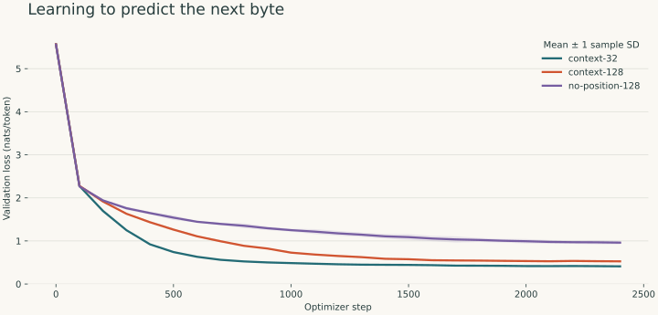

# Context Lab

**A small language model, built from first principles, with experiments you can reproduce.**

Context Lab implements a decoder-only transformer in PyTorch and investigates a specific question:
**under the same training-token budget, what changes when a model sees 32 versus 128 bytes of context?**
A third configuration removes learned positional embeddings. A fitted count-bigram provides a
simple baseline. The project includes repeated-seed measurements, a local text-generation demo,
and an attention inspector.

[Preview the attention inspector](docs/demo.jpg).



The core attention, causal mask, multi-head projection, residual blocks, weight tying, and
autoregressive sampling are implemented here. PyTorch provides tensor operations, automatic
differentiation, and AdamW. Training starts with random weights. No hosted model or API key is used.

## Try the trained model

Python 3.11 or newer is required. A CPU is sufficient for the bundled demo.

```bash
git clone https://github.com/michaelMerrick6/context-lab.git
cd context-lab
python -m venv .venv
source .venv/bin/activate
pip install -e '.[dev,demo]'

context-lab sample --checkpoint checkpoints/context-128-seed-7.pt --prompt "Mira found a"
streamlit run app.py
```

On Windows, activate with `.venv\Scripts\activate`. With [uv](https://docs.astral.sh/uv/),
`uv sync --extra dev --extra demo` installs the locked environment; prefix commands with `uv run`.

The checked-in checkpoint is the 128-context run with seed 7, chosen as the demo seed in advance.
The model learns a narrow procedural-fiction grammar. Expect repetition, incorrect names or colors,
and occasional malformed words. It is an educational language model with no factual grounding.
The [saved sample outputs](results/reference/samples.json) include these failures and their exact
sampling settings.

## Train and reproduce

```bash
# Generate 1,200 unique documents and an immutable fingerprinted 80/10/10 split.
context-lab prepare

# One training run. Use a fresh output directory for each run.
context-lab train --out runs/single --context 128 --steps 600 --seed 7

# Full reference: 3 configurations × 3 seeds × 2,400 steps.
context-lab suite --out runs/reference --steps 2400 --seeds 7 19 42 --threads 4

# Export raw measurements, a report, a learning-curve figure, and the demo checkpoint.
python scripts/export_results.py runs/reference

# Independently rescore the bundled checkpoint against the regenerated corpus.
context-lab evaluate --checkpoint checkpoints/context-128-seed-7.pt
```

The suite uses CPU as its reference backend. `train --device cuda` or `--device mps` can use a
compatible accelerator; deterministic-operation availability and numeric results can vary.
Checkpoints contain inference weights and configuration, rather than optimizer state for resuming.
Outputs refuse to overwrite an existing run directory.

For your own corpus, supply UTF-8 text with blank lines between documents:

```bash
context-lab prepare --source path/to/text.txt --out artifacts/custom-corpus
context-lab train --data artifacts/custom-corpus --out runs/custom
```

Verify your dataset's usage rights. Exact duplicate documents are removed; near duplicates and
shared sources require additional filtering for a serious natural-language experiment.

## What is measured

- **Held-out cross entropy:** total negative log likelihood divided by scored targets.
- **Perplexity:** `exp(cross_entropy)` with a fixed byte vocabulary. Lower is better on this corpus.
- **Seed variability:** mean and sample standard deviation across three training seeds.
- **Training throughput:** scored training targets per second, including batch construction and updates.
- **Context transfer:** score each checkpoint with evaluation chunks of 32, 64, and 128 tokens.

Every model is evaluated on the same held-out document transitions, with each target scored once.
Padding is ignored and targets never cross document boundaries. A checkpoint is selected using
validation loss; test results are recorded after training, without tuning on them.

The [600-step pilot](results/pilot/REPORT.md) is preserved alongside the 2,400-step reference.
The longer budget was chosen after inspecting poor pilot generation; both use the same test split,
so these are exploratory measurements. See the [experiment log](docs/experiment-log.md).

Read the [measured results and limitations](results/reference/REPORT.md) and
[experimental design](docs/methods.md) before interpreting the comparison. Equal token budgets do
not imply equal compute, and this small, template-based dataset cannot establish general language ability.

## Inside the model

```text
UTF-8 bytes + BOS/EOS
        ↓
token embedding + learned position embedding
        ↓
2 × [LayerNorm → causal multi-head attention → residual
     LayerNorm → 4× feed-forward network → residual]
        ↓
LayerNorm → tied vocabulary projection → next-byte probabilities
```

The default model has width 64, four attention heads, a 128-token position table, and dropout 0.1.
All code is small enough to trace from [attention](context_lab/model.py) through
[data sampling](context_lab/data.py) to [training and evaluation](context_lab/experiment.py).

## Verify and understand

```bash
pytest -q
ruff check .
ruff format --check .
```

The tests check future-token isolation, probability normalization, gradient flow, tiny-sequence
overfitting, deterministic data splits, exact evaluation coverage, masked padding, checkpoint reloads,
and the interactive demo. GitHub Actions runs the checks on pushes and pull requests.

The [learning guide](docs/learning-guide.md) explains the math, design decisions, interview questions,
and suggested next experiments. [MODEL_CARD.md](MODEL_CARD.md) records the model's intended uses
and known limits.

## References and development

The architecture follows [Attention Is All You Need](https://arxiv.org/abs/1706.03762) and the
decoder-only language-modeling pattern. Learning resources include
[Karpathy's GPT walkthrough](https://www.youtube.com/watch?v=kCc8FmEb1nY) and
[Hugging Face's causal-language-modeling course](https://huggingface.co/docs/course/chapter7/6).
Attention is implemented explicitly for readability; production implementations commonly use
[fused attention](https://docs.pytorch.org/docs/stable/generated/torch.nn.functional.scaled_dot_product_attention.html).

Developed with AI coding assistance. Reported measurements come from executing this repository's
training and evaluation code. Code, procedural corpus generator, and bundled weights are MIT licensed.
