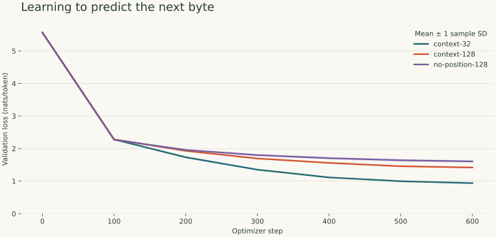

# 600-step experiment

These measurements were produced locally by the included suite. They describe a small synthetic corpus, not general language competence.
See the [experiment log](../../docs/experiment-log.md) for the pilot and follow-up history. The studies share a test split, so the follow-up is exploratory.

## Protocol

- Corpus fingerprint: `a476f7deb6a3570ef9043362d1388a4a71ffa7483e16867426265ee652ec89ba`.
- Document counts: `{'train': 960, 'validation': 120, 'test': 120}`.
- Seeds: `[7, 19, 42]`; 600 optimizer steps per run.
- 1,024 training targets per step; identical width, depth, and optimizer schedule.
- Select the checkpoint with lowest full validation loss; score the test set afterward.
- Evaluation resets context at chunk boundaries and scores every target exactly once.
- Mean ± sample standard deviation across seeds; no confidence interval is claimed.

## Held-out results

| Model | Parameters | Test loss (nats/token) | Test perplexity | Train tokens/sec |
|---|---:|---:|---:|---:|
| Count bigram | 66,564 counts | 1.902 | 6.703 | — |
| context-32 | 124,288 | 0.948 ± 0.016 | 2.580 ± 0.041 | 101,498 |
| context-128 | 124,288 | 1.427 ± 0.018 | 4.165 ± 0.074 | 76,392 |
| no-position-128 | 116,096 | 1.622 ± 0.035 | 5.065 ± 0.179 | 66,319 |



## Context at inference

Test perplexity at different evaluation chunk lengths, averaged across seeds. A 32-token-trained model evaluated at 64 or 128 encounters untrained absolute position embeddings; interpret those cells as distribution shift.

| Training variant | Eval 32 | Eval 64 | Eval 128 |
|---|---:|---:|---:|
| context-32 | 2.580 | 6.689 | 10.456 |
| context-128 | 6.429 | 5.802 | 4.165 |
| no-position-128 | 6.125 | 5.403 | 5.065 |

## Interpretation limits

- Template overlap remains even though exact documents are disjoint. The test set measures new combinations of familiar templates.
- Changing context also changes chunk boundaries and batch size. The comparison measures this complete training/evaluation policy.
- The no-position variant removes 8,192 learned parameters. Causal masking can still convey ordering information; this is not an orderless model.
- Equal token exposure is not equal compute. CPU throughput is descriptive and includes batch construction, forward/backward passes, and optimizer work.
- Perplexity is tokenization-dependent and does not establish reasoning, factuality, or useful text generation.
- Three seeds expose some variability; stronger claims need more runs and a separate natural-language corpus.

## Environment

```json
{
  "python": "3.13.5",
  "torch": "2.14.1",
  "platform": "macOS-15.6.1-arm64-arm-64bit-Mach-O",
  "device": "cpu",
  "threads": 4
}
```

Raw per-seed metrics and learning histories are in [summary.json](summary.json).
